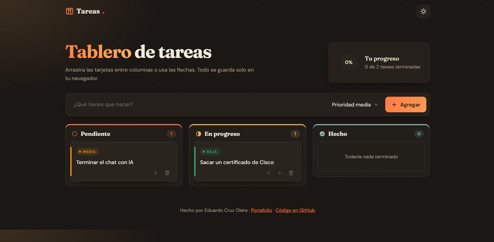

# Tablero de tareas (Kanban)

Tablero Kanban para organizar tus pendientes en tres columnas: **Pendiente**, **En progreso** y **Hecho**. Arrastra las tarjetas o muévelas con flechas, asígnales prioridad y mira tu avance en el anillo de progreso. Todo se guarda solo en tu navegador.

**Demo:** https://tablero-eduardocruz.netlify.app



## Funciones

- **Arrastrar y soltar** tarjetas entre columnas, con la columna destino resaltada.
- **Botones con flechas** para mover tareas sin arrastrar, útiles en celular y con teclado.
- **Prioridades** alta, media y baja, cada una con su color.
- **Anillo de progreso** con el porcentaje de tareas terminadas, que se llena con animación.
- **Guardado automático** en el navegador con `localStorage`. Al volver, tus tareas siguen ahí.
- **Animaciones** al agregar, mover y borrar tareas, y un "sello" al terminar una.
- **Limpiar terminadas** con un solo botón.
- **Modo claro y oscuro**, diseño responsive (mobile first) y accesible: textos para lectores de pantalla y respeto a `prefers-reduced-motion`.

## Seguridad

Los títulos de las tareas se muestran con `textContent`, nunca con `innerHTML`. Si alguien escribe código como `` en una tarea, se ve como texto y no se ejecuta (prevención de XSS).

## Tecnologías

- HTML5, CSS3 (variables, Grid, Flexbox, `@property`, `conic-gradient`) y JavaScript (ES6+), sin frameworks.
- API de arrastrar y soltar de HTML5 (`dragstart`, `dragover`, `drop`).
- Delegación de eventos: un solo listener maneja los botones de todas las tarjetas.
- `localStorage` para guardar las tareas y el tema.
- Íconos SVG propios.

## Cómo usarlo

1. Clona el repositorio:

   ```bash
   git clone https://github.com/eduardocruzoleta-prog/tablero-tareas.git
   ```

2. Abre `index.html` con Live Server en VS Code, o directamente en el navegador.

No necesita instalar nada.

## Estructura

```
tablero-tareas/
├── index.html   # estructura del tablero y los íconos SVG
├── style.css    # diseño "papel y tinta", temas y responsive
└── script.js    # tareas, arrastrar y soltar, progreso y guardado
```

## Lo que aprendí

- Usar la API de arrastrar y soltar de HTML5.
- Manejar el estado de la app (un arreglo de tareas) y volver a dibujar la interfaz a partir de él.
- Usar delegación de eventos en lugar de un listener por botón.
- Prevenir XSS mostrando el texto del usuario con `textContent`.
- Animar valores de CSS con `@property` para el anillo de progreso.

## Autor

**Eduardo Cruz Oleta**: estudiante de Ingeniería en Tecnologías de la Información e Innovación Digital, Universidad Politécnica de Sinaloa.

- Portafolio: https://portafolio-eduardocruz.netlify.app
- GitHub: [@eduardocruzoleta-prog](https://github.com/eduardocruzoleta-prog)